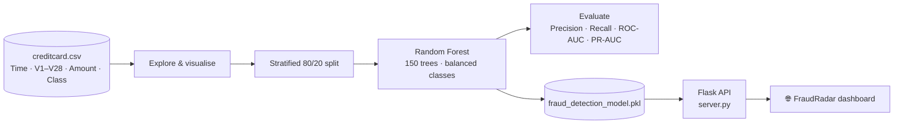
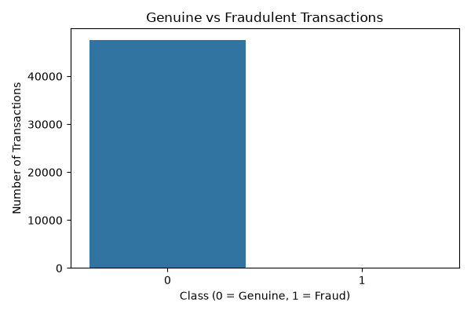
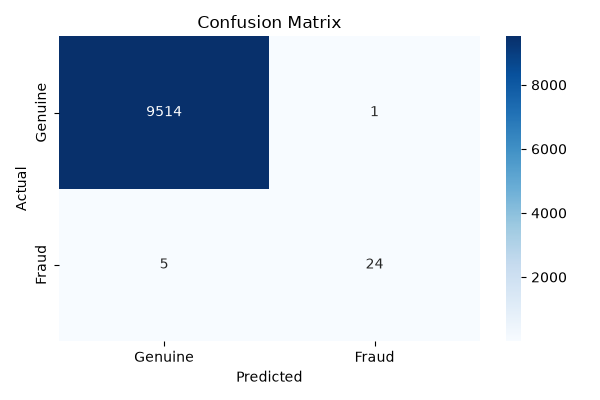
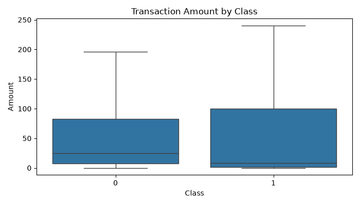

<div align="center">

# 💳 FraudRadar

### Every swipe leaves a fingerprint. This model reads it.

**Credit card fraud detection with Python & Machine Learning**, built on a Random Forest and served through a dark, interactive web dashboard.

[](https://credit-card-fraud-detection-1-9o7h.onrender.com)
<br>


```
   ┌──────────────────────────────┐
   │  RADAR//BANK            )))  │        30 hidden signals in
   │  ▣▣                          │  ───▶  150 decision trees vote
   │  4532 •••• •••• 7710         │        ✅ GENUINE   or   🚨 FRAUD
   └──────────────────────────────┘
```

</div>

---

## 🕵️ The problem

Out of every **1,000** card transactions, fewer than **2** are fraud. That's a needle in a haystack. A lazy model that answers "genuine" every time would be **99.8% accurate** and catch **zero** fraud.

This project trains a model that actually finds the needles, then puts it behind a web app anyone can try.

### 🎯 Objectives

| # | Goal |
| :-: | :--- |
| 1 | Detect fraudulent credit card transactions |
| 2 | Classify each transaction as **genuine** or **fraudulent** |
| 3 | Reduce financial losses caused by fraud |
| 4 | Improve transaction security using machine learning |

---

## ✨ The web app

<div align="center">

**👉 [Try it live](https://credit-card-fraud-detection-1-9o7h.onrender.com) 👈**

<sub>Free hosting: the first visit after a quiet spell can take ~30–60 s while the server wakes up.</sub>

</div>

| Screen | What you can do |
| :--- | :--- |
| 🔍 **Check transaction** | Pull a real genuine or fraudulent transaction. A 3D card swipes, a gauge swings to the fraud probability, a **FRAUD / GENUINE** stamp lands, and a bar chart shows its V1–V28 signal fingerprint. The app also tells you whether the model got it right. |
| 📡 **Batch scanner** | Drop a CSV on the scanner bed. Every row is scored and ranked riskiest-first, split into a risk spectrum (low → critical), and can be exported as a CSV. If the file has a `Class` column, you also get accuracy, frauds caught and false alarms. |
| 🧠 **Model insights** | See which signals the 150 trees rely on most, the dataset stats, and the evaluation plots. |

---

## 🧬 How it works



1. **Load** the transaction dataset and inspect it
2. **Visualise** genuine vs fraudulent transactions and their amounts
3. **Split** into features (X) and target (y), then 80% train / 20% test, *stratified* so fraud stays proportional
4. **Train** a Random Forest with `class_weight="balanced_subsample"` so the rare fraud class isn't drowned out
5. **Evaluate** with accuracy, precision, recall, F1, ROC-AUC, PR-AUC and a confusion matrix
6. **Save** the model with joblib
7. **Serve** it through a Flask API to the web dashboard


---

## 📊 What the data says

| | |
| :--- | :--- |
| 📦 Transactions in `creditcard.csv` | **47,718** |
| 🚨 Of which are fraud | **146** (≈ 0.31%) |
| 🔐 Features | `Time`, `Amount` and **V1–V28**: PCA-transformed signals, kept anonymous to protect cardholders |
| 🏷️ Target | `Class`: `0` = genuine, `1` = fraud |

**The signals the model trusts most** (Random Forest feature importance):

```
V14  ████████████████████  19.9%
V10  ██████████████        13.8%
V4   ███████████           11.4%
V12  ███████████           10.6%
V3   ██████████             9.6%
V17  ███████                6.7%
```

<div align="center">



<br>
<sub>Class imbalance · Confusion matrix · Amount by class</sub>
</div>

### 📏 Model evaluation

| Metric | What it tells us |
| :--- | :--- |
| Accuracy | Overall correct predictions |
| Precision | Of the transactions flagged as fraud, how many really were fraud |
| **Recall** | **Of the real frauds, how many were caught** |
| F1-score | Balance between precision and recall |
| Confusion matrix | Correct vs incorrect predictions per class |
| ROC-AUC | How well the model separates the two classes |
| **PR-AUC** | **Performance on heavily imbalanced data** |

> [!IMPORTANT]
> Fraud data is extremely imbalanced, so **recall, precision and PR-AUC** are the numbers that matter. High accuracy on its own means nothing here.

---

## 🛠️ Tech stack

| Layer | Tools |
| :--- | :--- |
| Language | Python |
| Data | Pandas · NumPy |
| Visualisation | Matplotlib · Seaborn |
| Machine learning | Scikit-learn (Random Forest) · Joblib |
| Web backend | Flask · Gunicorn |
| Web frontend | HTML · CSS · vanilla JavaScript (no build step) |
| Notebook / IDE | Jupyter Notebook · VS Code |
| Hosting | Render |

---

## 🚀 Run it yourself

```bash
git clone https://github.com/Dhara1199/Credit-Card-Fraud-Detection.git
cd Credit-Card-Fraud-Detection
pip install -r requirements.txt
```

| Want to… | Run |
| :--- | :--- |
| 🏋️ Retrain the model and regenerate plots | `python main.py` |
| 🧪 Score a CSV from the terminal | `python predict.py sample_test_data.csv` |
| 🌐 Launch the FraudRadar dashboard | `python server.py` → open http://localhost:5000 |
| 🎈 Launch the original Streamlit app | `streamlit run app.py` |

> 📥 The full dataset is on Kaggle: [Credit Card Fraud Detection](https://www.kaggle.com/datasets/mlg-ulb/creditcardfraud). Place `creditcard.csv` next to `main.py`.

### ☁️ Deploy on Render

| Setting | Value |
| :--- | :--- |
| Build command | `pip install -r requirements.txt` |
| Start command | `gunicorn server:app --workers 1 --threads 4 --timeout 120 --bind 0.0.0.0:$PORT` |
| Environment | `PYTHON_VERSION=3.11.9` |

`render.yaml` contains the same settings for Blueprint deploys.

---

## 🗂️ Project structure

```
Credit-Card-Fraud-Detection/
├── main.py                       # train + evaluate + save the model
├── predict.py                    # score a CSV from the command line
├── server.py                     # Flask API + web server
├── app.py                        # original Streamlit app
├── templates/index.html          # dashboard layout
├── static/style.css              # dashboard styling
├── static/app.js                 # dashboard behaviour
├── fraud_detection_model.pkl     # trained Random Forest
├── creditcard.csv                # transaction dataset
├── sample_test_data.csv          # labelled sample (for demos)
├── sample_test_unlabeled.csv     # unlabelled sample (for the batch scanner)
├── Credit_Card_Fraud_Detection.ipynb
├── *.png                         # evaluation plots
├── requirements.txt
└── render.yaml
```

---

<div align="center">

**Built with 🐍 Python, 🌲 150 decision trees and a healthy suspicion of $1.00 transactions at 2 a.m.**

⭐ If this project helped you, consider giving it a star!

</div>
